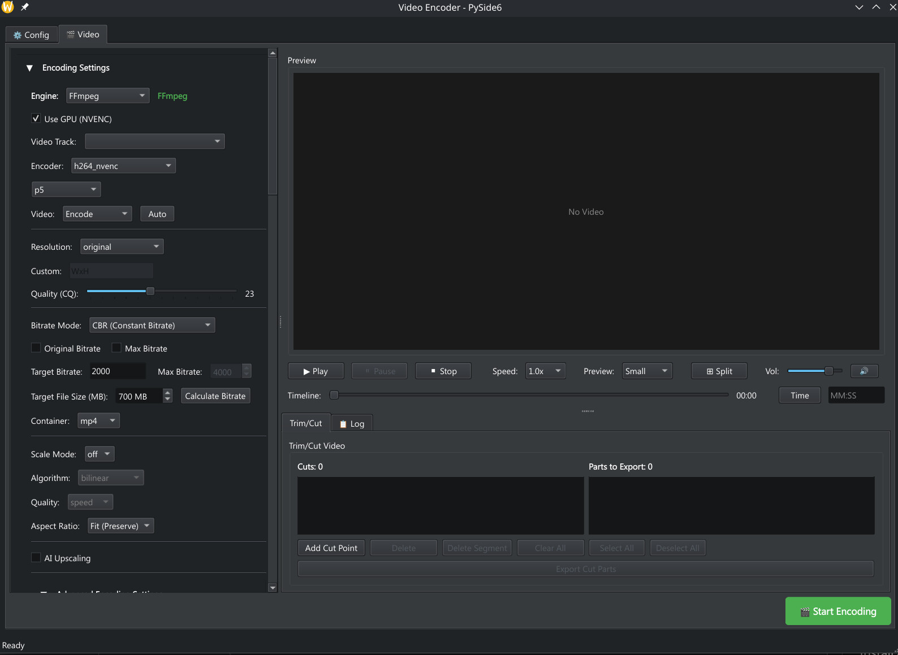

# Akira Stream Encoder



A feature-rich video encoding application built with **PySide6 (Qt6)** and **FFmpeg**, designed for both quick transcodes and advanced multi-track workflows.

## Features

- **Multi-track encoding** — encode multiple video, audio, and subtitle tracks in one pass
- **FFmpeg & GStreamer backends** — switch between engines in settings
- **Trim / Cut panel** — side-by-side source/preview with frame-accurate trimming
- **AI upscaling** — Real-ESRGAN & Anime4K (Vulkan) integration
- **AI colorization** — optional PyTorch-based colorization (ECCV16, SIGGRAPH, DeOldify, BigColor, DDColor)
- **DVD subtitle burning** — HandBrake CLI fallback for bitmap subtitles
- **Frame number timeline** — navigate by frame number
- **Hardware encoding** — NVENC, AMF, QSV support via FFmpeg
- **Target file size** — single-pass encoding with size targeting
- **CQ / bitrate modes** — configurable quality control

## Getting Started

See [INSTALL.md](INSTALL.md) for full setup instructions.

### Quick start

```bash
pip install -r requirements.txt
python3 PySide6/main.py
```

## Requirements

- Python 3.10+
- PySide6, numpy, Pillow, mutagen
- FFmpeg static build (see INSTALL.md)
- Optional: GStreamer, HandBrake CLI, AI upscaling/colorization binaries
